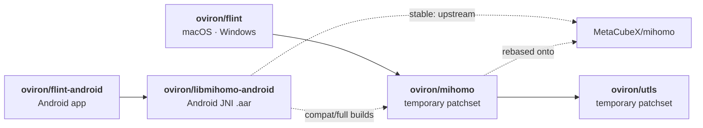

# oviron/mihomo

**Temporary layered patchset on top of [MetaCubeX/mihomo](https://github.com/MetaCubeX/mihomo) for current TLS fingerprints and Xray-core 26.11.9 interoperability.**

**English** · [Русский](README.ru.md)

  
  
  
  

  <a href="#three-temporary-layers">Layers</a> ·
  <a href="#what-upstream-currently-lacks">Patch Matrix</a> ·
  <a href="#upstream-convergence-policy">Convergence Policy</a> ·
  <a href="#flint-ecosystem">Flint Ecosystem</a>

> [!IMPORTANT]
> **This is a temporary bridge fork, not a permanent replacement for upstream.**
> It exists solely while [MetaCubeX/mihomo](https://github.com/MetaCubeX/mihomo) lags behind on specific features needed against current `Xray-core 26.11.9` servers and modern browser TLS ClientHellos. Every layer is cleanly rebased onto new upstream release tags, and individual patches are **dropped as soon as upstream merges equivalents**.

---

## Three Temporary Layers

Each branch sits directly on top of the previous one so consumers can pick the smallest delta they need:

| Branch | Sits on | What it adds | Technical spec | Delta size |
| :--- | :--- | :--- | :--- | :--- |
| **`utls`** | `MetaCubeX/mihomo` tag | Replaces `metacubex/utls` with [oviron/utls](https://github.com/oviron/utls) (Firefox 158, Chrome 155, P-256 key-share fix, zstd CVE fix) | [FORK.md](FORK.md) | `go.mod` replace + `chrome155` |
| **`compat`** *(default)* | `utls` | Client-side interoperability fixes against an `Xray-core 26.11.9` server (verified in CI against a real `xray` binary) | [FORK-COMPAT.md](FORK-COMPAT.md) | ~460 lines |
| **`full`** | `compat` | Client side of newer Xray-core server features not yet in upstream (`finalmask`, `Mux.Cool`, `MASQUE`, `XDrive`, `xdns`, reverse) | [FORK-FULL.md](https://github.com/oviron/mihomo/blob/full/FORK-FULL.md) | ~17k lines |

`compat` is the default branch used daily by [oviron/flint](https://github.com/oviron/flint) and offered as an optional core in [oviron/flint-android](https://github.com/oviron/flint-android) via [oviron/libmihomo-android](https://github.com/oviron/libmihomo-android).

## What Upstream Currently Lacks

| Area | Upstream `v1.19.34` | This patchset | Layer |
| :--- | :--- | :--- | :--- |
| **Browser TLS parrots** | `firefox` = Firefox 148; no Chrome 155 | `firefox` = Firefox 158 (with 240B GREASE ECH + X25519MLKEM768); adds `chrome155` | `utls` |
| **P-256 key-share & zstd CVE** | Drops P-256 private key; `klauspost/compress v1.17.9` | Keeps every classical key share; bumps `klauspost/compress` to `v1.20.4` (`GHSA-fpmh-frq8-7rj8`) | `utls` |
| **XTLS Vision padding** | Unpadded inner ClientHello ≥ 900 B (exposes PQ ClientHello size) | Supports Xray's `testseed` padding law and waits for whole TLS records before direct copy | `compat` |
| **XHTTP / HTTPUpgrade / gRPC / REALITY parity** | Minor option & header mismatches with Xray-core 26.11.9 | Xray-compatible padding/query/method defaults, `?ed=N`, `client-version`, `grpc-opts.authority`, hybrid-only `random` over REALITY, expired XHTTP pool fix (#3479) | `compat` |
| **SOCKS5 / VLESS enc / XUDP** | Ignored SOCKS5 error reply; 17000 B vlessenc bound; per-process XUDP ID | Enforces SOCKS5 reply code, 16640 B bound, and optional `MIHOMO_XUDP_BASEKEY` | `compat` |
| **Newer Xray transports** | Not implemented yet | `finalmask`, `Mux.Cool`, `MASQUE`, `XDrive`, `xdns` client support | `full` |

Every fix in `compat` and `full` is tested against a real `ghcr.io/xtls/xray-core:26.11.9` binary in `xraytest/` on every push (`.github/workflows/oviron-test.yml`).

## Upstream Convergence Policy

- **No permanent divergence:** patches are never stacked into a custom fork identity; module structure and config syntax stay compatible with upstream `MetaCubeX/mihomo`.
- **Drop-on-rebase:** on every new upstream release tag `vNEW`, branches are rebased bottom-up (`utls` → `compat` → `full`), and any patch already landed in upstream is removed.
- **Release naming:** tags follow `v<upstream>-<layer>.<n>` (for example `v1.19.34-compat.2`), with `mihomo-linux-arm64-<tag>.gz`, `mihomo-darwin-arm64-<tag>.gz`, and `SHA256SUMS`.
- **Upstream docs & bug reports:** for general mihomo documentation see [wiki.metacubex.one](https://wiki.metacubex.one/) and [MetaCubeX/mihomo](https://github.com/MetaCubeX/mihomo).

## Flint Ecosystem

| Repository | Role | Lifecycle |
| :--- | :--- | :--- |
| **[oviron/flint](https://github.com/oviron/flint)** | Native desktop client (macOS AppKit, Windows WPF) | Standalone app |
| **[oviron/flint-android](https://github.com/oviron/flint-android)** | Android client (Flutter + Kotlin Material 3) | Standalone app |
| **[oviron/libmihomo-android](https://github.com/oviron/libmihomo-android)** | Standalone Android JNI `.aar` library wrapping mihomo | Standalone library |
| **[oviron/mihomo](https://github.com/oviron/mihomo)** | Layered patchset on `MetaCubeX/mihomo` (`utls` / `compat` / `full`) | Temporary upstream bridge |
| **[oviron/utls](https://github.com/oviron/utls)** | Firefox 158, Chrome 155, P-256 key-share & zstd CVE fixes | Temporary upstream bridge |

## License

GNU General Public License v3.0 (GPL-3.0), unchanged from [MetaCubeX/mihomo](https://github.com/MetaCubeX/mihomo). See [LICENSE](LICENSE).
