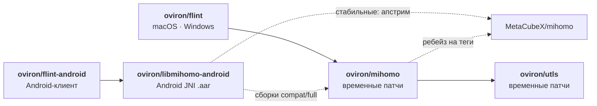

# oviron/mihomo

**Временный многослойный набор патчей поверх [MetaCubeX/mihomo](https://github.com/MetaCubeX/mihomo) для актуальных TLS-отпечатков и совместимости с Xray-core 26.11.9.**

[English](README.md) · **Русский**

  
  
  
  

  <a href="#три-временных-слоя">Слои</a> ·
  <a href="#чего-сейчас-не-хватает-в-апстриме">Матрица патчей</a> ·
  <a href="#политика-возврата-к-апстриму">Политика возврата</a> ·
  <a href="#экосистема-flint">Экосистема Flint</a>

> [!IMPORTANT]
> **Это временный форк-мост, а не постоянная замена апстрима.**
> Он существует только пока [MetaCubeX/mihomo](https://github.com/MetaCubeX/mihomo) отстаёт по конкретным актуальным фичам для работы с серверами `Xray-core 26.11.9` и свежими TLS-отпечатками браузеров. Каждый слой чисто ребейзится на новые теги апстрима, а отдельные патчи **удаляются сразу, как только аналоги принимаются в апстрим**.

---

## Три временных слоя

Ветки выстроены слоями одна поверх другой, чтобы потребители могли брать минимально необходимую дельту:

| Ветка | База | Что добавляет | Спецификация | Объём |
| :--- | :--- | :--- | :--- | :--- |
| **`utls`** | тег `MetaCubeX/mihomo` | Подменяет `metacubex/utls` на [oviron/utls](https://github.com/oviron/utls/blob/oviron/README.ru.md) (Firefox 158, Chrome 155, фикс P-256 key share и zstd CVE) | [FORK.md](FORK.md) | `replace` в `go.mod` + `chrome155` |
| **`compat`** *(по умолчанию)* | `utls` | Фиксы совместимости клиента с сервером `Xray-core 26.11.9` (проверяются в CI против реального бинарника `xray`) | [FORK-COMPAT.md](FORK-COMPAT.md) | ~460 строк |
| **`full`** | `compat` | Клиентская часть новых возможностей Xray-core (`finalmask`, `Mux.Cool`, `MASQUE`, `XDrive`, `xdns`, reverse) | [FORK-FULL.md](https://github.com/oviron/mihomo/blob/full/FORK-FULL.md) | ~17 тыс. строк |

Ветка `compat` используется по умолчанию в [oviron/flint](https://github.com/oviron/flint/blob/main/README.ru.md) и доступна как опциональное ядро в [oviron/flint-android](https://github.com/oviron/flint-android/blob/main/README.ru.md) через [oviron/libmihomo-android](https://github.com/oviron/libmihomo-android/blob/main/README.ru.md).

## Чего сейчас не хватает в апстриме

| Область | Апстрим `v1.19.34` | Этот набор патчей | Слой |
| :--- | :--- | :--- | :--- |
| **TLS-отпечатки браузеров** | `firefox` = Firefox 148; нет Chrome 155 | `firefox` = Firefox 158 (с 240-байтным GREASE ECH и X25519MLKEM768); добавлен `chrome155` | `utls` |
| **P-256 key share и zstd CVE** | Теряет приватный ключ P-256; `klauspost/compress v1.17.9` | Сохраняет все классические key share; обновлён `klauspost/compress` до `v1.20.4` (`GHSA-fpmh-frq8-7rj8`) | `utls` |
| **Паддинг XTLS Vision** | Не паддит внутренний ClientHello ≥ 900 Б (выдаёт размер PQ ClientHello) | Поддерживает закон паддинга `testseed` из Xray и ждёт целые TLS-записи перед direct copy | `compat` |
| **Совместимость XHTTP / HTTPUpgrade / gRPC / REALITY** | Мелкие расхождения опций и заголовков с Xray-core 26.11.9 | Дефолты XHTTP, `?ed=N`, `client-version`, `grpc-opts.authority`, только гибридные отпечатки для `random` поверх REALITY, фикс протухшего пула XHTTP (#3479) | `compat` |
| **SOCKS5 / VLESS enc / XUDP** | Игнорирует код отказа SOCKS5; лимит 17000 Б; XUDP ID на процесс | Проверка кода ответа SOCKS5, лимит 16640 Б, переменная `MIHOMO_XUDP_BASEKEY` | `compat` |
| **Новые транспорты Xray** | Пока не реализованы | Клиентская поддержка `finalmask`, `Mux.Cool`, `MASQUE`, `XDrive`, `xdns` | `full` |

Все правки в `compat` и `full` на каждый пуш проверяются интеграционными тестами `xraytest/` против реального `ghcr.io/xtls/xray-core:26.11.9`.

## Политика возврата к апстриму

- **Без долгосрочного расхождения:** структура модулей и формат конфига остаются совместимыми с апстримом `MetaCubeX/mihomo`.
- **Сброс патчей при ребейзе:** на каждый новый тег апстрима ветки перебазируются снизу вверх (`utls` → `compat` → `full`), а патчи, уже попавшие в апстрим, удаляются.
- **Теги релизов:** `v<upstream>-<layer>.<n>` (например `v1.19.34-compat.2`), бинарники `linux-arm64` и `darwin-arm64` с `SHA256SUMS`.
- **Общая документация mihomo:** см. [wiki.metacubex.one](https://wiki.metacubex.one/) и [MetaCubeX/mihomo](https://github.com/MetaCubeX/mihomo).

## Экосистема Flint

| Репозиторий | Роль | Статус |
| :--- | :--- | :--- |
| **[oviron/flint](https://github.com/oviron/flint/blob/main/README.ru.md)** | Нативный десктопный клиент (macOS AppKit, Windows WPF) | Самостоятельный продукт |
| **[oviron/flint-android](https://github.com/oviron/flint-android/blob/main/README.ru.md)** | Android-клиент (Flutter + Kotlin Material 3) | Самостоятельный продукт |
| **[oviron/libmihomo-android](https://github.com/oviron/libmihomo-android/blob/main/README.ru.md)** | Отдельная Android JNI-библиотека `.aar` поверх mihomo | Самостоятельная библиотека |
| **[oviron/mihomo](https://github.com/oviron/mihomo/blob/compat/README.ru.md)** | Слои патчей поверх `MetaCubeX/mihomo` (`utls` / `compat` / `full`) | Временный форк до апстрима |
| **[oviron/utls](https://github.com/oviron/utls/blob/oviron/README.ru.md)** | Firefox 158, Chrome 155, фикс P-256 key share и zstd CVE | Временный форк до апстрима |

## Лицензия

GNU General Public License v3.0 (GPL-3.0), без изменений относительно [MetaCubeX/mihomo](https://github.com/MetaCubeX/mihomo). См. [LICENSE](LICENSE).
